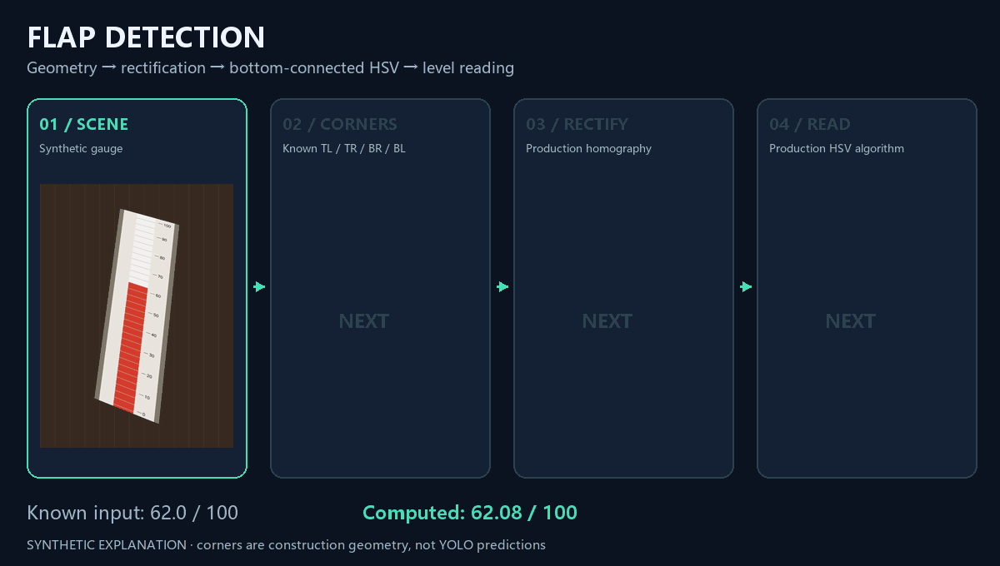
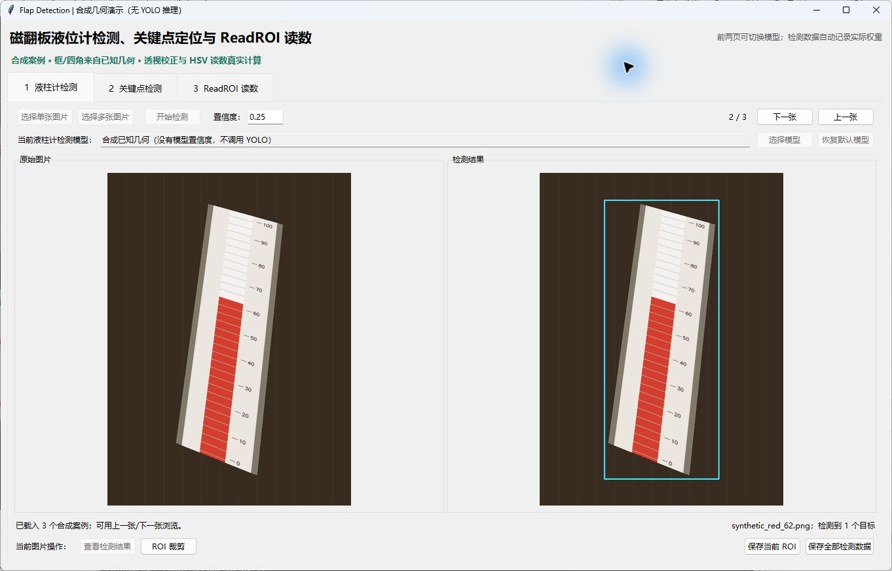
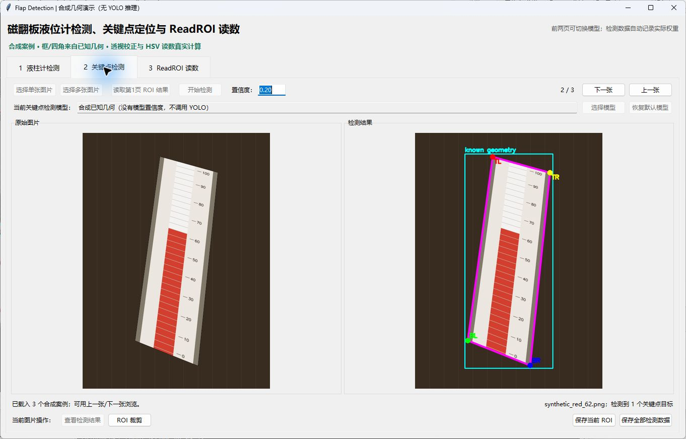
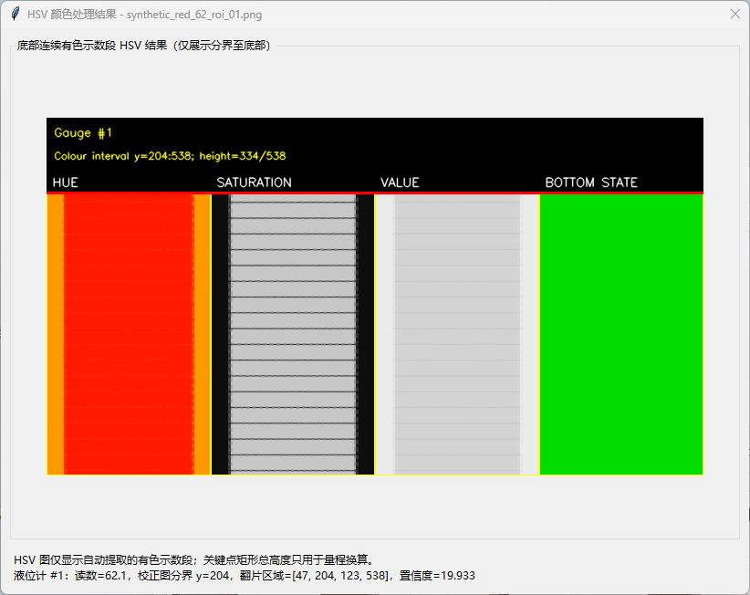
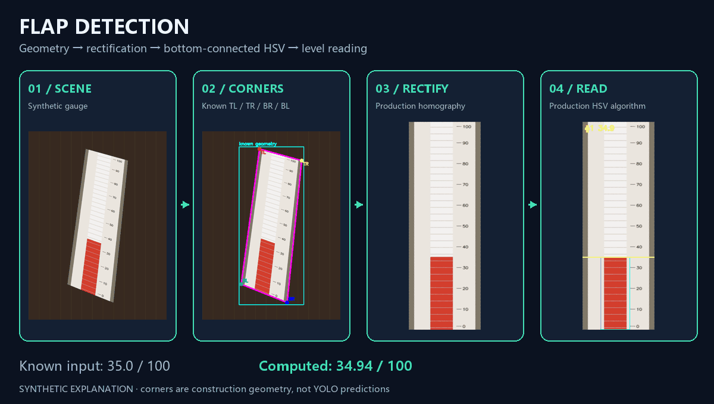
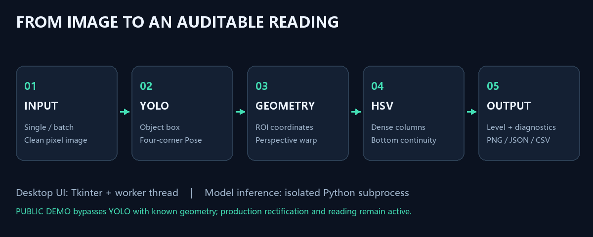
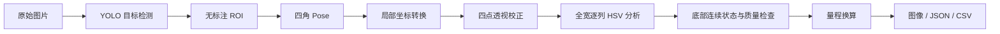

<div align="center">

# Flap Detection

### 磁翻板液位计视觉检测与读数

从仪表图像到可解释的液位结果：**目标定位 · 四角关键点 · 透视校正 · 自适应颜色带 · 连续状态读数**


[快速体验](#快速体验) · [界面展示](#界面展示) · [完整操作](docs/USAGE.md) · [算法解析](docs/ALGORITHM.md)

</div>



> 上图使用程序生成的合成液位计。框与四角来自已知几何，**不是 YOLO 推理结果**；透视校正与 HSV 读数调用本项目实际代码。真实图片推理需要业务数据和训练后的权重。

## 项目解决什么问题

仪表在现场图片中通常较小，拍摄角度会使颜色分界和刻度倾斜，金属框、刻度线、翻片缝隙也会干扰液位定位。本项目将问题拆成可检查的阶段：先找到液位计及四个角，再把有效量程区域校正为矩形，最后沿翻片颜色状态寻找连续分界并换算读数。

这是一套研究与演示工程，包含桌面交互、单图/批量处理、标注辅助和评估工具。主要阶段都能输出可视化与结构化记录，方便定位“框没找到”“四点不对”或“颜色区域不连续”等问题。

| 能力 | 实现与用途 |
| --- | --- |
| 目标检测 | YOLO 定位液位计，保存框、检测图与原始像素 ROI |
| 四角关键点 | Pose 定位 `TL → TR → BR → BL`，保留坐标与置信度 |
| 透视校正 | 四点单应变换，将有效量程区域变为标准矩形 |
| 自适应翻片定位 | 全宽逐列分析，聚合分界高度稳定的连续列 |
| 液位读数 | 从有效底部追踪 HSV 状态，连接短缝隙，拒绝明显多重分界 |
| 桌面展示 | 三页 Tkinter 界面，对比结果、切换模型、量程输入、结果保存 |
| 批量与评估 | 断点续跑、JSON/CSV 汇总、人工真值配对与误差统计 |
| 标注辅助 | 矩形提示的 SAM 辅助标注与 YOLO 标签可视化 |
| 无权重体验 | `--demo` 运行公开合成案例，体验界面和实际读数算法 |

## 界面展示

以下为**实际运行的桌面程序截图**，均来自公开合成演示模式。检测框和关键点是已知构造几何；生产模式的相同页面由 YOLO 服务提供预测结果。

### 1. 目标定位

左侧保留输入图，右侧显示液位计框。真实推理模式支持多图浏览、模型切换和 ROI 裁剪。



### 2. 四关键点

四角按 `TL、TR、BR、BL` 顺序连接。显示用的框线不参与读数，后续颜色分析使用无标注原始像素。



### 3. 校正与读数

对比无标注输入、未校正读数、校正矩形和正式结果。示例量程为 `0–100`，合成液位为 `62`；计算值与未校正对比可在界面查看。


<details>
<summary>展开：HSV 中间结果与动态液位演示</summary>



GIF 将合成液位在 `35–78` 之间往返变化，每帧重新执行校正和读数。这是离线合成序列，**不是摄像头实时推理演示，也不体现模型推理速度**。



</details>

## 快速体验

推荐 Python 3.10 或 3.11。轻量合成模式只需 NumPy、OpenCV、Pillow，以及系统提供的 Tkinter，不需要 PyTorch、GPU、数据集或模型权重。

```bash
git clone https://github.com/HermitKin/flap_detection.git
cd flap_detection
python -m venv .venv
```

激活环境：

```powershell
# Windows PowerShell
.\.venv\Scripts\Activate.ps1
```

```bash
# Linux / macOS
source .venv/bin/activate
```

安装并启动：

```bash
python -m pip install -r requirements-demo.txt
python level_gauge_showcase/app.py --demo
```

1. 第一页查看原图/框，用“上一张/下一张”浏览三个合成案例。
2. 第二页查看四角；选择案例后进入第三页，点击“使用关键点检测当前图片/数据”。
3. 修改量程上下限，点击“开始读数”，查看校正与读数结果。
4. 点击“查看检测结果”查看 HSV 图。本地文件保存在 `.demo-work/`。

演示模式禁用模型加载与重新调用模型入口，框和关键点不显示伪造的模型置信度。退出后不带 `--demo` 启动即可进入真实推理模式。

Linux 若缺少 Tkinter，可安装发行版对应的 `python3-tk`；没有桌面环境时，可直接运行下文的素材构建与算法测试。

## 真实图片推理

```bash
python -m pip install -r level_gauge_showcase/requirements.txt
```

按本地训练环境安装适合的 PyTorch。若权重依赖仓库自定义结构，需要匹配的本地 Ultralytics 源码与依赖。`environment.yml` 保留历史训练配置，和轻量演示依赖用途不同。

默认业务权重布局：

```text
level_gauge_showcase/models/
├── object_detector.pt     # 液位计目标检测权重
└── pose_keypoints.pt      # 四角权重，顺序 TL / TR / BR / BL
```

```bash
python level_gauge_showcase/app.py
```

也可在页面中点击“选择模型”。通用人体 Pose 权重不能直接代替四角液位计模型，需要任务标注与训练/微调。

操作顺序：选择图片 → 第一页检测 → 第二页读取 ROI 并检测关键点 → 第三页使用当前关键点结果 → 输入量程 → 开始读数 → 查看/保存结果。按钮、坐标转换与训练准备见 [操作指南](docs/USAGE.md)。

### 单图命令行

```bash
python read_level_single_image.py example.jpg \
  --model path/to/pose_keypoints.pt \
  --scale-min 0 --scale-max 100 \
  --output-root outputs/single
```

以上反斜杠是 Bash 换行语法；PowerShell 可写成一行。

### 服务器批量

```bash
cd level_gauge_showcase
python remote_batch_reading.py \
  --source /workspace/images \
  --pose-model /workspace/models/pose_keypoints.pt \
  --output /workspace/results
```

脚本逐张询问量程，支持 `q` 保存退出、`s` 跳过，续跑默认跳过已有结果；`--range-csv` 可载入量程表。详见 [服务器说明](level_gauge_showcase/REMOTE_BATCH_README.md)。

## 原理与流程





目标框用于定位，四角定义有效量程。在校正图中，算法将 Hue 映射到圆周，避免红色跨越色相端点时出现不连续距离；结合饱和度与亮度后，计算每行更接近顶部还是底部状态。


从有效底部向上追踪同一状态，短翻片缝隙通过闭运算连接，再聚合分界稳定的相邻列。校正高度为 `H`、分界行为 `y*`、量程为 `[Lmin, Lmax]`，代码采用：

$$r = \frac{H-y^*}{H}, \qquad L = L_{min} + r\,(L_{max}-L_{min})$$

图像纵坐标从顶部向下增大；顶部对应量程上限，底部对应下限。完整推导、候选评分、默认阈值和拒检条件见 [算法解析](docs/ALGORITHM.md)。

## 复现与验证

构建脚本生成合成图，调用 `ReadingService` 和 `direct_hsv_reader`，输出静态图、GIF 和数值记录：

```bash
python tools/build_showcase_assets.py
python -m unittest discover -s tests -v
```

素材位于 `docs/assets/`，来源见 [清单](docs/assets/README.md)。桌面截图需打开 `--demo` 后单独截取。

[synthetic-results.json](docs/assets/synthetic-results.json) 记录红/蓝两色、`35 / 62 / 78` 三个液位。这些案例检验几何、坐标与公式一致性，**不替代真实场景的 Precision、Recall、mAP、PCK 或读数 MAE/RMSE**。

| 合成颜色 | 已知液位（量程 0–100） | 算法计算 | 绝对差值 |
| --- | ---: | ---: | ---: |
| 红 | 35 | 34.944 | 0.056 |
| 红 | 62 | 62.082 | 0.082 |
| 红 | 78 | 78.067 | 0.067 |
| 蓝 | 35 | 34.944 | 0.056 |
| 蓝 | 62 | 61.896 | 0.104 |
| 蓝 | 78 | 78.067 | 0.067 |

表格对应当前公开合成素材的重算结果，插值与浮点差异可能使最后几位随 OpenCV 版本略有变化。GitHub Actions 会自动运行无模型测试与展示链接/素材检查。

```bash
python level_gauge_showcase/evaluation/evaluate_pipeline.py
```

评估真实读数前先填写人工真值。未校正/校正读数差值只能反映流程差异，不能单独证明准确性。GUI 当前只完整保存成功读数的 JSON，统计总体成功率时还需固定尝试清单并记录失败样本。详见 [评估说明](level_gauge_showcase/evaluation/README.md)。

## 项目结构

```text
flap_detection/
├── README.md                       # 项目入口与可视化展示
├── requirements-demo.txt            # 轻量演示依赖
├── environment.yml                 # 历史训练环境
├── docs/
│   ├── USAGE.md                     # GUI、CLI、训练与评估
│   ├── ALGORITHM.md                 # 原理推导与实现索引
│   └── assets/                      # 截图、GIF、图解
├── level_gauge_showcase/
│   ├── app.py                       # 三页桌面界面
│   ├── services.py                  # 推理、ROI、校正、保存
│   ├── direct_hsv_reader.py         # 默认读数算法
│   ├── synthetic_demo.py            # 合成几何与复现
│   ├── public_demo.py               # 无权重界面案例
│   ├── remote_batch_reading.py      # 服务器批量入口
│   ├── evaluation/                  # 真值配对与统计
│   └── legacy/                      # 旧版辅助脚本
├── object detection/               # 本地 Ultralytics 及训练实验
├── sam3_level_annotator/             # SAM 辅助标注
├── read_level_single_image.py        # 单图完整流程
├── tools/build_showcase_assets.py    # 素材生成
└── tests/test_public_demo.py         # 无模型算法测试
```

## 使用边界

- **量程标定**：四角应围住同一完整线性量程；包含额外上下端盖会使比例换算偏移。
- **方向约定**：公式假设下部颜色段对应液位、刻度向上增大；反向刻度需要调整标定。
- **端点读数**：严格算法要求稳定的上/下参考区，接近空/满量程时可能拒检，未实现独立端点分类器。
- **反光与遮挡**：多次大段颜色重现、参考状态过近、候选过窄/过宽可能拒检；算法置信度是启发式评分，不是概率。
- **视频**：目前提供图片工作流和离线动画，没有摄像头追踪、时间滤波或实测 FPS。
- **本地资源**：数据集、业务权重、个人文档和运行产物由使用者本地准备，不纳入本仓库。

## 许可与参考

Ultralytics 衍生实现遵循 [AGPL-3.0](object%20detection/LICENSE)。其他文件未另行授予独立宽松许可；使用和分发时请同时检查依赖许可。

- [Ultralytics：Pose 数据格式](https://docs.ultralytics.com/datasets/pose/)
- [OpenCV：几何变换](https://docs.opencv.org/4.x/da/d54/group__imgproc__transform.html)
- [OpenCV：形态学操作](https://docs.opencv.org/4.x/d9/d61/tutorial_py_morphological_ops.html)

算法细节以本仓库实现为准。展示素材、参数与限制均对应代码，没有宣称未验证的工业部署精度。
