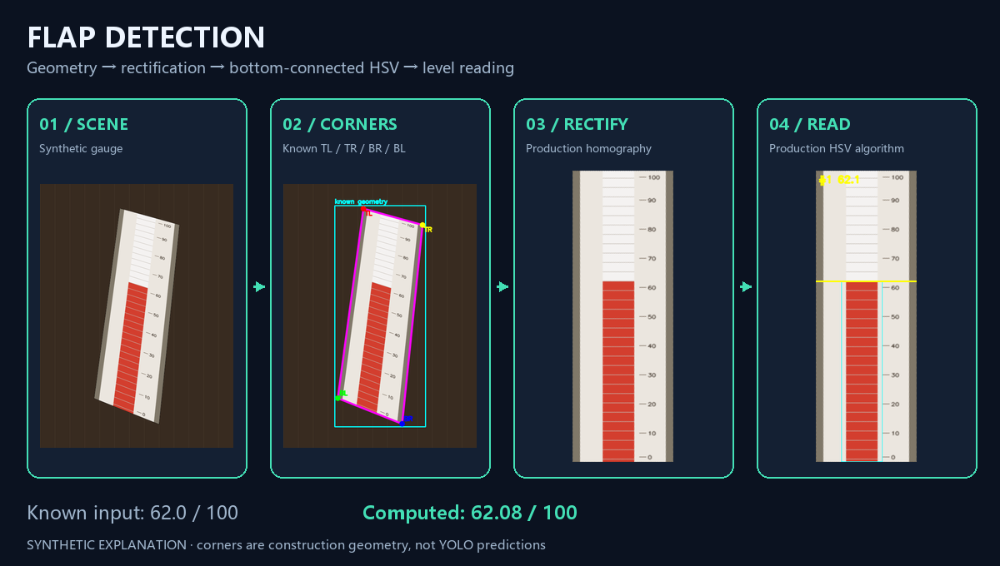
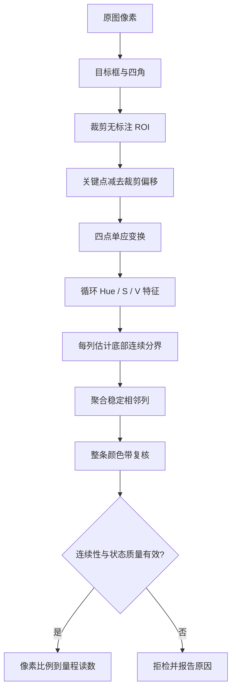
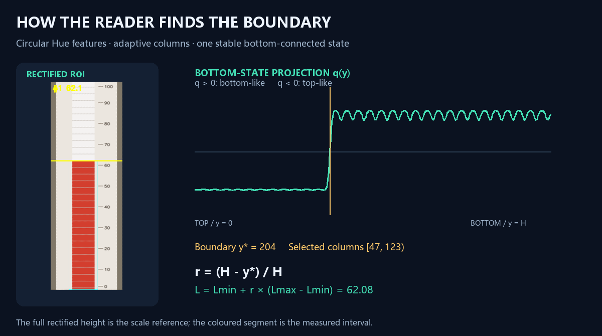

# 算法解析：从四角几何到连续颜色状态

[返回项目首页](../README.md) · [操作指南](USAGE.md)

本文对应默认桌面读数链路：`services.py` 调用 `direct_hsv_reader.py`。根目录的单图脚本包含相近实现；`legacy_candidate_reader.py` 是对照版本，不是当前 GUI 的自动回退算法。

## 1. 为什么拆成检测、几何和颜色三层

目标检测负责回答“仪表在哪里”，关键点负责回答“有效量程区域的四个角在哪里”，颜色分析负责回答“翻片状态从哪一行开始变化”。三者分别产生框、四边形和分界行。这样可以直接观察每一阶段的结果，而不把所有误差混入最终读数。





## 2. 坐标与四角定义

顺序固定为：

```text
TL ───────── TR      x →
│             │      y ↓
│  有效量程区 │
│             │
BL ───────── BR

数组顺序：[TL, TR, BR, BL]
```

若原图中框左上角为 `(x0, y0)`，裁剪后的关键点必须使用 `p_local = p_source - (x0, y0)`。把原图坐标直接用于 ROI 会产生偏移；交换角点顺序可能导致翻转或交叉变换。

GUI 的第二页展示标注图，但第三页使用第二页保存的**无标注原始裁剪图**。透视之前必须转换为该裁剪图的局部坐标。对应实现为 `ReadingTab._use_detection_record()`。

## 3. 透视校正

四个源角点与目标矩形四角构成对应关系。代码取上/下边长度的较大值作为目标宽度、左/右边长度的较大值作为目标高度，使用 `cv2.getPerspectiveTransform()` 求 3×3 单应矩阵 `M`，再用 `cv2.warpPerspective()` 重采样。

$$\lambda\begin{bmatrix}u\\v\\1\end{bmatrix}=M\begin{bmatrix}x\\y\\1\end{bmatrix}$$

目标角点是 `(0,0)、(W−1,0)、(W−1,H−1)、(0,H−1)`。实现会检查四点形状、有限值、坐标范围和输出大小。当前检查不等价于完整的四边形凸性/自交验证，关键点顺序与有效性仍需由上游保证。

矩形高度必须覆盖手动输入的完整量程。这里采用的是线性尺度比例，不是 OCR 识别刻度，也没有自动确定上下限。

实现：[ReadingService._rectify_quad](../level_gauge_showcase/services.py)。OpenCV 的矩阵约定与接口见 [官方几何变换文档](https://docs.opencv.org/4.x/da/d54/group__imgproc__transform.html)。

## 4. 为什么用循环 Hue 表示

OpenCV 8 位 HSV 的 Hue 范围是 `0–179`，两端在色相环上相邻。直接用 `|h1−h2|` 会在跨端点时高估颜色差异。代码将每个像素转为：

$$\theta = \frac{2\pi h}{180},\quad s=\frac{S}{255},\quad v=\frac{V}{255}$$

$$\phi(h,S,V)=[s\cos\theta,\;s\sin\theta,\;s,\;v]$$

色相两个分量乘以饱和度：低饱和度像素的 Hue 方向权重较低。S 与 V 提供另外两个状态分量，因此算法没有写死“红色 Hue 必须落在哪一个区间”。这不表示它能适配所有颜色布局；仍需要稳定、可区分的上下状态。

每列使用局部水平窗口，对四维特征求行均值，再沿竖直方向平滑。选出颜色带后，整条带也按同一方法计算行特征。对应 `_hsv_embedding()` 和 `extract_hsv_row_features()`。

## 5. 底部连续状态

对高度为 `H` 的行特征 `f(y)`，默认先避开上下各约 `5%` 的端部，再从顶部和底部各取约 `10%` 高度作为参考区，用中位数得到 `t` 与 `b`。

设 `a=b−t`、`m=(t+b)/2`，投影分数为：

$$q(y)=\frac{(f(y)-m)\cdot a}{\max(a\cdot a,10^{-6})}$$

参考中心理想分数约为 `−0.5` 和 `+0.5`。`q>0` 表示更接近底部状态，`q<0` 表示更接近顶部状态。此分数是相对状态投影，不是液位高度，也不是模型概率。



1. 当上下参考距离 `||b−t|| < 0.05` 时拒检，避免对几乎一致的颜色硬找分界。
2. 对 `q>0` 的一维掩码做闭运算，填补允许长度内的翻片小缝隙。
3. 验证底部参考原始状态的一致率达到 `70%`。
4. 从有效底部向上追踪连续状态，在断开位置得到 `y*`。
5. 复核上下状态一致率、分界距端点距离，以及上部是否大段重新出现底部颜色。

闭运算用于连接短间隙，不会把所有遮挡都当作有效颜色。超过允许长度的上部状态重现会拒检，以减少复杂遮挡和多重分界带来的误读。参考 [OpenCV 形态学说明](https://docs.opencv.org/4.x/d9/d61/tutorial_py_morphological_ops.html)。

对应 `find_bottom_connected_boundary()`。

## 6. 颜色带不是固定中心裁剪

校正 ROI 可能同时包含刻度、边框和翻片，因此不能直接对整幅图求一个颜色边界。当前算法逐列寻找底部连续分界，构造：

- `boundary_map[x]`：有效列的候选分界高度；无效列记为缺失。
- `confidence_map[x]`：上下状态分离度与一致性的启发式评分。
- `separation_map[x]`：参考颜色状态的距离。

然后将水平相邻、分界高度接近的有效列聚成候选带。候选需要符合宽度、间隙与稳定性约束。不会把固定中心窗口直接作为最终颜色带，但仍有局部窗口比例、候选宽度限制和弱中心先验。

候选定位评分可概括为：

$$Q_{loc}\propto\frac{w}{W}\log(1+c_{median})\max(stability,0.1)\,centerPrior$$

`centerPrior` 仅在 `0.90–1.00` 间变化；最终还需对整条带重算连续状态。选取 `continuity_confidence × localization_confidence` 最大的有效候选。刻度区可能存在强边缘，但未必能满足底部颜色连续性，因此会在此阶段被排除。

对应 `locate_colour_strip_by_dense_columns()` 与 `analyze_direct_flap_strip()`。

## 7. 默认参数与实际约束

下表来自当前源码，比例还会受最小像素数和奇数核大小调整影响。

| 参数 | 默认 | 影响 |
| --- | --- | --- |
| 上下端部 margin | `5% H`，至少 4 行 | 避开端部；并非把换算高度改为去端部高度 |
| 参考区 | `10% H`，至少 12 行 | 建立上下状态 |
| 短缝隙闭运算 | `2.5% H`，至少 3 行奇数核 | 连接小间隙 |
| 状态一致率 | `0.70` | 过滤颜色不稳定的上下段 |
| 上下参考距离 | 至少 `0.05` | 防止近似统一状态 |
| 局部水平窗口 | 约 `10% W` | 每列使用邻域特征 |
| 有效列评分 | 至少 `2.5` | 保留可靠候选列 |
| 分界高度容差 | `2.5% H`，至少 4 行 | 聚合相近分界 |
| 候选水平间隙 | `3% W`，至少 1 列 | 容忍少量无效列 |
| 候选宽度 | 约 `8%–65% W` | 限制可接受颜色带宽度 |

这些阈值是代码默认经验值，不是完成泛化评测后的最优参数。近空/满、颜色区占比异常、非线性刻度或翻片布置不同的仪表，需要重新标定或调整算法。

## 8. 换算与诊断

当前实现按整幅校正图高度换算：

$$r=\frac{H-y^*}{H},\qquad L=L_{min}+r(L_{max}-L_{min})$$

边界检测避开了端部参考干扰，但分母仍是完整高度 `H`，不是有效底部位置。检测图显示分界线与从分界到底部的颜色段；JSON 同时记录完整高度、分界行、比例、透视矩阵、颜色带坐标和连续性指标。

例如 `H=538`、`y*=204`、量程 `0–100`，读数约为 `62.08`。改变成 `20–220` 时，同一比例读数约为 `144.16`。这些是公开合成例子的几何换算，不是传感器实测。

## 9. 计算开销与误差来源

当前逐列代码对每个局部窗口重新计算均值，并重复平滑与连续性分析；粗略上界随 `H × W × local_width` 增长，此外还有候选逐组复核。它不是已经优化为常数时间滑窗的实现，也没有给出实测实时 FPS。

读数误差可来自：目标定位、四角偏移、透视重采样、颜色带误选、遮挡、量程端点定义和仪表颜色语义。透视校正有助于规范几何，但是否改善真实精度必须用人工真值判断。

当前算法拒绝不满足连续性条件的场景，没有自动回退到旧版候选法。`continuity_confidence` 和 `change_confidence_z` 是诊断评分，不能解释为“读数正确概率”。

## 10. 实现索引

| 阶段 | 代码 |
| --- | --- |
| 图像与模型页面 | [app.py](../level_gauge_showcase/app.py) |
| 子进程推理协议与保存 | [services.py](../level_gauge_showcase/services.py) |
| 四维颜色状态、列聚合、分界 | [direct_hsv_reader.py](../level_gauge_showcase/direct_hsv_reader.py) |
| 合成几何与实际读数复现 | [synthetic_demo.py](../level_gauge_showcase/synthetic_demo.py) |
| 单图完整流程 | [read_level_single_image.py](../read_level_single_image.py) |
| 评估与人工真值 | [evaluate_pipeline.py](../level_gauge_showcase/evaluation/evaluate_pipeline.py) |

## 11. 验证该怎么做

合成测试用于发现坐标和公式问题：红/蓝两色、已知液位、非零下限和拒检场景。真实测试集应按场景固定划分，保存每一次尝试，包括失败和拒检，再分别评估目标框、角点和最终读数。

检测指标可用 Precision/Recall 与 mAP；关键点需人工角点配对计算 PCK 或归一化误差；最终读数用人工真值计算 MAE、RMSE、满量程归一化误差与命中率。只有 GUI 成功文件或两条流程差值，无法证明完整系统准确率。
