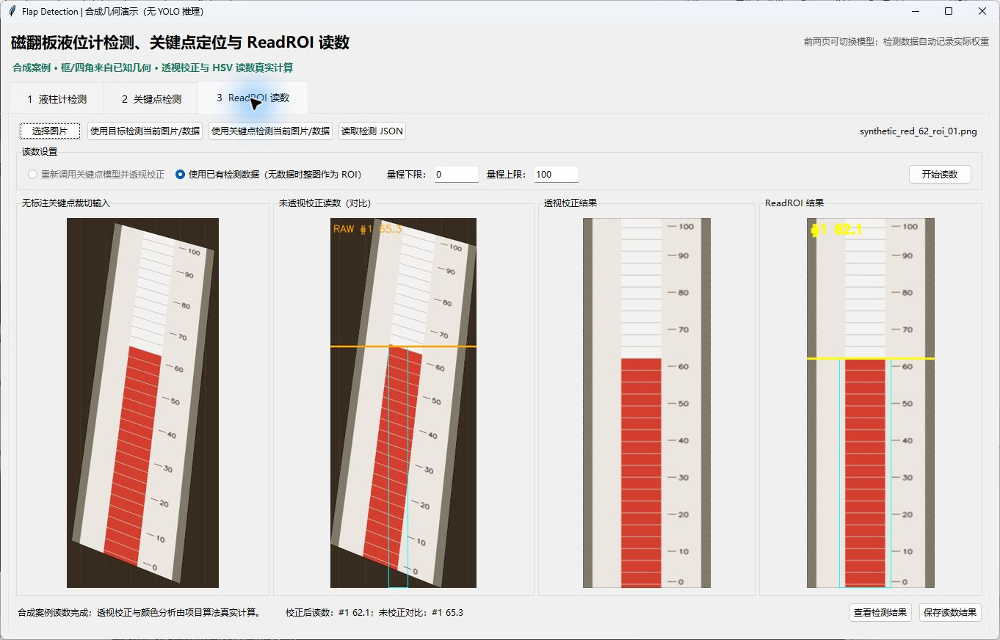

# 操作指南

[返回项目首页](../README.md) · [算法解析](ALGORITHM.md)

下面的命令默认从仓库根目录运行。Bash 多行命令在 PowerShell 中可以合为一行；模型、图片和数据路径均替换为自己的本地资源。

## 1. 选哪条启动路线

| 路线 | 需要资源 | 命令 |
| --- | --- | --- |
| 公开合成体验 | 轻量依赖 + 桌面环境 | `python level_gauge_showcase/app.py --demo` |
| 真实桌面推理 | PyTorch + 业务权重 + 图片 | `python level_gauge_showcase/app.py` |
| 单图完整流程 | 四角模型 + 图片 | `python read_level_single_image.py --help` |
| 服务器批量 | 四角模型 + 图片目录 | `python level_gauge_showcase/remote_batch_reading.py --help` |
| 无界面素材生成 | 轻量依赖 | `python tools/build_showcase_assets.py` |

## 2. 轻量演示

```bash
python -m venv .venv
# 激活方式见首页
python -m pip install -r requirements-demo.txt
python level_gauge_showcase/app.py --demo
```

案例为红色液位 `35`、红色液位 `62`、蓝色液位 `78`，量程默认 `0–100`。框与四角来自构造时的已知几何，界面明确标注无 YOLO 推理；校正与颜色读数仍使用正式 `ReadingService`。



可以在第二页切换案例，再到第三页点击“使用关键点检测当前图片/数据”，修改量程并“开始读数”。上部与下部状态必须稳定；轻量模式没有伪造模型置信度或性能指标。

## 3. 真实推理环境

```bash
python -m pip install -r level_gauge_showcase/requirements.txt
```

默认模型位置写在 `level_gauge_showcase/config.py`，也能在界面中临时选择。默认目标模型为 `models/object_detector.pt`，四角模型为 `models/pose_keypoints.pt`。

标准业务权重可以使用匹配版本的官方 Ultralytics 环境。包含本地自定义网络层的权重，需要安装匹配的仓库源码及该网络依赖，例如：

```bash
python -m pip install -e "object detection"
```

本地 fork 的一些扩展模块依赖额外包或编译算子。`environment.yml` 是历史 GPU 训练环境参考，不能视作全部架构的一键兼容保证。不要在同一环境中交替覆盖不兼容的官方与定制实现；检查 `python -c "import ultralytics; print(ultralytics.__file__)"` 确认实际来源。

## 4. 桌面操作步骤

### 第一页：目标检测

1. 点击“选择单张图片”或“选择多张图片”。
2. 点击“选择模型”指定目标检测权重，设置置信度阈值。
3. 点击“开始检测”。左侧为原图，右侧为检测图。
4. 使用“上一张/下一张”浏览结果；“查看检测结果”显示明细。
5. 原始像素 ROI 随检测自动裁剪保存，不使用界面缩略图作为后续输入。

### 第二页：关键点

1. 可以直接选择图片，或点击“读取第1页 ROI 结果”。
2. 选择四角业务 Pose 权重并“开始检测”。
3. 确认四角顺序 `TL → TR → BR → BL` 覆盖完整有效量程。
4. 标注图、坐标 JSON 和无标注 ROI 自动保存。

### 第三页：ReadROI

1. 点击“使用关键点检测当前图片/数据”。程序读取第二页的无标注 ROI，并转换关键点坐标。
2. 选择“使用已有检测数据”；也可对新图选择“重新调用关键点模型并透视校正”。
3. 填写量程下限和上限，上限必须大于下限。
4. 点击“开始读数”。查看未透视对比、校正图与正式读数。
5. 点击“查看检测结果”查看 HSV 图；成功结果自动落盘，也可手动“保存读数结果”。

当前 GUI 从第二页快捷载入时选取第一份有效 ROI。需要完整遍历多仪表时，可使用单图 CLI 或服务器批量程序。

三页的模型推理运行在单独 Python 子进程中，界面使用工作线程调度；主进程执行 OpenCV/图像展示，降低 Windows OpenMP 库冲突的风险。

## 5. 单图命令

```bash
python read_level_single_image.py example.jpg \
  --model ./models/pose_keypoints.pt \
  --confidence 0.20 --imgsz 960 \
  --scale-min 0 --scale-max 100 \
  --output-root ./outputs/single
```

省略图片参数会打开文件选择框，省略量程会在终端询问。脚本保存关键点、校正、颜色区间、HSV 处理与 JSON。

桌面目录中还有服务器单图入口，它使用服务器默认路径与设备设置：

```bash
cd level_gauge_showcase
python single_image_reading.py /workspace/images/example.jpg \
  --pose-model /workspace/models/pose_keypoints.pt \
  --scale-min 0 --scale-max 100 --device cpu \
  --output /workspace/results/single
```

## 6. 批量处理与断点续跑

```bash
cd level_gauge_showcase
python remote_batch_reading.py \
  --source /workspace/images \
  --pose-model /workspace/models/pose_keypoints.pt \
  --output /workspace/results \
  --device cpu
```

`--source`、`--pose-model`、`--output` 建议始终显式提供。默认配置面向 GPU 容器，不是所有本机目录都适用。量程输入时 `q` 保存退出，`s` 跳过；再次运行默认跳过已保存结果，`--no-resume` 可重新处理。

量程表需要列名：

```csv
image_name,scale_min,scale_max
example_01.jpg,0,100
example_02.jpg,20,220
```

```bash
python remote_batch_reading.py --source /workspace/images \
  --pose-model /workspace/models/pose_keypoints.pt \
  --output /workspace/results --range-csv /workspace/ranges.csv --device cpu
```

更多功能见 [服务器 README](../level_gauge_showcase/REMOTE_BATCH_README.md)。

## 7. 训练与标注准备

仓库不带训练数据和业务权重。四角 Pose 数据应保证每个样本的关键点语义、顺序和有效量程一致，按场景分组划分训练/验证/测试，避免相邻近重复图片同时出现在训练与测试中。

```text
local_data/
├── images/train/    images/val/
├── labels/train/    labels/val/
└── pose.yaml
```

`pose.yaml` 示例：

```yaml
path: /absolute/path/to/local_data
train: images/train
val: images/val
names:
  0: flap
kpt_shape: [4, 3]
flip_idx: [1, 0, 3, 2]
```

单条标签为 `class cx cy w h` 后跟四组 `x y visibility`，坐标归一化到 `[0,1]`。见 [Ultralytics 官方 Pose 数据文档](https://docs.ultralytics.com/datasets/pose/)。

在兼容的 Ultralytics 环境中，通用微调命令可写为：

```bash
yolo pose train model=yolo11n-pose.pt data=./local_data/pose.yaml imgsz=960 epochs=100 device=cpu
```

这是自备数据的训练模板，不是已训练液位计权重。生产训练可选择合适 GPU 并修改批量等参数。仓库原有训练脚本保留了历史容器路径和多 GPU 参数，运行前需按环境调整。

矩形提示 SAM 标注的操作见 [标注工具](../sam3_level_annotator/README.md)，该工具导出的是分割轮廓标签，不应直接当作四角 Pose 标签使用。

## 8. 保存与数据字段

```text
level_gauge_showcase/outputs/
├── object_detection/   # 检测图、框 JSON、ROI
├── keypoint_detection/ # 标注图、关键点 JSON、ROI
└── read_roi/
    ├── input_roi/                    # 无标注输入
    ├── unrectified_comparison/        # 未校正对比
    ├── rectified_images/              # 标准矩形
    ├── detection_results/             # 颜色段与分界线
    ├── flap_color_strips/             # 分界到底部颜色段
    ├── hsv_results/                   # HSV 可视化
    └── data/                          # 结构化读数与诊断
```

JSON 读数字段包含 `reading`、`level_ratio`、`boundary_y_rectified`、`full_scale_height`、`perspective_matrix`、`strip_localization` 和连续性指标。本地生产输出会记录绝对输入/模型/结果路径，分享前应单独脱敏，不能直接将整个 `outputs/` 上传。

## 9. 评估与复现

```bash
python level_gauge_showcase/evaluation/evaluate_pipeline.py
```

首次运行生成真值表；填写 `actual_reading` 后再次运行，查看两种流程的 MAE、RMSE、满量程归一化误差与命中率。现有 GUI 成功文件不能提供完整尝试分母，完整评测需额外记录失败、拒检和全部测试清单。

轻量流程测试与素材重建：

```bash
python -m unittest discover -s tests -v
python tools/build_showcase_assets.py
```

## 10. 常见故障

| 现象 | 检查与处理 |
| --- | --- |
| 找不到模型 | 使用匹配的业务权重；核对 `config.py` 或在界面选择 |
| Pose 输出 17 点 | 用了人体 Pose 权重；应训练四角任务 |
| `ModuleNotFoundError` 自定义层 | 当前 Ultralytics 与权重架构不匹配，安装对应源码和依赖 |
| 图像无法读取 | 检查格式、路径及文件损坏；保留原始像素图 |
| 透视翻转或扭曲 | 检查四角顺序与 ROI 局部坐标 |
| 无连续颜色区域 | 检查反光、遮挡、空/满端点、状态差异及有效量程 |
| 读数比例稳定但实际偏移 | 检查上下限、四角量程端点与颜色语义 |
| Tkinter 无法启动 | 安装 Tk 支持并在桌面会话运行；服务器可改用 CLI |

以上界面与命令是图片工作流，GIF 是离线解释素材，没有额外视频推理接口。
