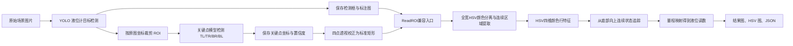

# 磁翻板液位计检测与读数系统阶段汇报

## 1. 项目概述

本阶段完成了一套面向磁翻板液位计的可视化检测与读数展示程序，将液位计目标检测、关键点定位、ROI 裁剪和基于 HSV 特征的液位读数整合到统一桌面界面中。

系统支持单张或多张图片顺序处理，并实现了页面间检测数据直接传递、检测结果自动保存和结果详情可视化，可用于算法演示、现场图片快速验证以及后续透视矫正和读数算法迭代。

程序目录：

```text
flap_detection/level_gauge_showcase
```

启动方式：

```powershell
python level_gauge_showcase/app.py
```

## 2. 当前完成内容

### 2.1 液位计目标检测

第一页用于从原始场景图片中定位完整液位计，已实现：

- 选择单张或多张图片；
- 多图后台逐张检测，避免界面卡死；
- 显示原始图片与检测标注图；
- 自动保存检测标注图和目标框 JSON；
- 按检测框在原始分辨率图片上自动裁剪 ROI；
- 自动保存每个目标对应的 ROI 图片；
- 支持上一张、下一张切换；
- 点击“查看检测结果”弹出检测详情，包括类别、检测框坐标和置信度。

### 2.2 液位计关键点检测

第二页用于在液位计或液位计 ROI 中检测四个角点，已实现：

- 支持单图、多图关键点检测；
- 可直接读取第一页当前会话的检测记录和全部 ROI；
- 页面间传递不再打开文件选择框；
- 自动保存关键点标注图、关键点 JSON 和关键点检测 ROI；
- 四点顺序统一为 `TL、TR、BR、BL`；
- 关键点数据同时保存像素坐标和归一化坐标；
- 点击“查看检测结果”弹出标注图、检测框位置、检测框置信度、各关键点坐标和关键点置信度。

### 2.3 ReadROI 液位读数

第三页用于根据液位计图像计算当前液位，已实现：

- 手动输入量程下限和上限；
- 可重新调用关键点模型定位液位计并执行透视校正；
- 可直接读取第二页无标注 ROI 和四关键点数据；
- 根据 `TL、TR、BR、BL` 计算透视矩阵并校正为标准矩形；
- 使用相同关键点外接矩形生成未透视校正读数图，作为前后对比；
- 可读取已有检测 JSON；
- 在透视校正矩形完整宽度中自适应提取磁翻板颜色区域；
- 自动检测上下翻片状态的分界位置；
- 根据分界位置和手动量程换算液位读数；
- 主界面显示无标注输入图、未透视读数对比图、透视校正图和最终读数图；
- 点击“查看检测结果”后，弹出完整 HSV 颜色处理结果；
- 自动保存读数图、HSV 分析图和读数 JSON。

## 3. 系统流程



## 4. 关键技术要点

### 4.1 目标检测模型

- 框架：Ultralytics YOLO；
- 模型文件：`models/object_detector.pt`；
- 当前默认推理尺寸：`640`；
- 当前默认置信度阈值：`0.25`；
- 输出内容：类别、目标框 `xyxy` 坐标、检测置信度；
- ROI 裁剪直接使用原图像素坐标，不使用界面缩略图。

界面只对图片进行等比例缩略显示，模型输入记录、裁剪结果和保存结果均保持原始像素尺寸，避免缩放引入坐标偏移。

### 4.2 四关键点定位模型

- 框架：Ultralytics YOLO Pose；
- 模型文件：`models/pose_keypoints.pt`；
- 当前模型：YOLO11s Pose 关键点模型；
- 当前默认推理尺寸：`960`；
- 当前默认置信度阈值：`0.20`；
- 四点定义：左上 `TL`、右上 `TR`、右下 `BR`、左下 `BL`；
- 同时保存检测框置信度和每个关键点的独立置信度；
- 输出像素坐标、归一化坐标以及可供透视变换直接读取的四边形字段。

关键点模型当前主要负责液位计平面初始定位。后续如进行透视矫正，应结合关键点置信度、边缘拟合或直线约束修正角点，避免直接使用偏移关键点造成矫正后液位计仍然倾斜。

### 4.3 页面间数据联动

第一页检测完成后，每张图片对应一个内存检测记录，内容包括：

- 原始图片；
- 检测标注图；
- 检测框和置信度；
- ROI 图像；
- 已保存的标注图、JSON 和 ROI 路径。

第二页点击“读取第1页 ROI 结果”时，直接读取这些内存记录及 `saved_crops`，将全部 ROI 加入第二页待检测队列。因此数据传递不依赖用户再次定位输出目录，也不会误选其他图片。

第二页界面继续展示带框线、连线和关键点的标注图，但第三页不会读取该标注图或第二页裁剪前的输入图。第三页直接读取第二页按关键点检测框保存的无标注 ROI 裁剪图，并将四关键点减去裁剪框左上角坐标，转换到 ROI 局部坐标系；随后使用 `getPerspectiveTransform` 与 `warpPerspective` 得到标准矩形，再在无绘制污染的校正图上完成 HSV 读数。

### 4.4 HSV 无固定颜色读数方法

当前读数算法不只判断红色，也不再固定裁取中央区域。关键点矩形透视校正后，程序在标准矩形完整宽度上逐列从底部追踪循环 Hue、S、V 状态，将分界高度相近且横向连续的列组合成翻片颜色区域，再对整个区域进行正式读数。

#### 4.4.1 翻片颜色区域自适应定位

- 分析校正矩形的完整宽度，不设置固定中心；
- 以约校正图宽度10%的局部窗口逐列计算 HSV 行特征；
- 每一列都独立从底部向上追踪连续颜色状态，得到一张横向“分界高度图”；
- 只保留连续性置信度不低于2.5的有效列；
- 将相邻、分界高度差不超过约2.5%图高的列组合成连续区域；
- 允许跨过极少量无效列，但区域宽度必须处于合理范围；
- 如果反光和真实翻片产生不同分界高度，它们会被拆成不同区域；
- 多个区域按有效宽度、分界稳定性和连续性置信度综合选择，中心位置只占很弱的排序权重，不是硬约束；
- 颜色带使用校正矩形完整高度，不搜索上下量程区域；
- 校正矩形顶部、底部分别默认对应量程上限、下限；
- 没有可靠区域时直接拒绝读数，不回退到中央24%裁剪。

#### 4.4.2 行特征提取

对自适应提取的颜色带每一行计算以下颜色特征：

- Hue 的正弦、余弦循环编码；
- Saturation 均值；
- Value 均值。

Hue 在 OpenCV 中是循环变量，`0` 和 `179` 实际相邻，因此算法使用 `sin/cos` 编码，并根据饱和度降低低饱和区域中不可靠 Hue 的权重。

#### 4.4.3 底部起始与连续性判定

- 先忽略上下各5%的端部边缘，再分别取顶部和底部10%高度的中位特征作为两个颜色参考；
- 由“底部参考－顶部参考”构造颜色状态轴，每一行投影到该轴，正值为更接近底部颜色状态；
- 要求底部参考区至少70%的行属于底部状态，否则拒绝读数；
- 对二值状态序列执行纵向闭运算，只填补不超过约2.5%图高的短间隙，用于容忍翻片缝隙、反光和少量污渍；
- 从有效底部向上逐行追踪连通区域，第一次真正断开的位置作为液面分界；
- 如果底部状态在分界上方又连续出现超过允许间隙长度，判定可能存在遮挡或多重分界并拒绝读数；
- 分界上下两段各自至少70%的行必须符合所属颜色状态，且分界不能贴近量程端点；
- 连续性置信度由上下状态中位差、MAD波动和两段一致率共同计算，它不是神经网络概率。

#### 4.4.4 HSV 结果可视化

点击第三页“查看检测结果”后，弹窗完整显示：

- `HUE`：色相伪彩色结果；
- `SATURATION`：饱和度灰度结果；
- `VALUE`：亮度灰度结果；
- `BOTTOM STATE`：绿色为与底部连通的颜色状态，蓝色为上部状态；
- 红色横线：底部连通状态终止的位置，也是最终液位读数位置。

HSV 图片按完整宽高比例显示，不截断，并自动保存到 `outputs/read_roi/hsv_results/`。

### 4.5 液位量程换算

当前假设检测 ROI 顶部对应量程上限、底部对应量程下限。设：

- ROI 高度为 `H`；
- 液面局部坐标为 `y`；
- 量程下限为 `Lmin`；
- 量程上限为 `Lmax`。

液位比例与读数计算如下：

```text
ratio = (H - 1 - y) / (H - 1)
reading = Lmin + ratio × (Lmax - Lmin)
```

量程由用户在第三页手动输入，因此同一套流程可以适配不同量程液位计。

## 5. 输出文件结构

```text
outputs/
├─ object_detection/
│  ├─ detected_images/    # 目标检测标注图
│  ├─ data/               # 目标框与置信度 JSON
│  └─ roi_crops/          # 第一页按检测框裁剪的 ROI
├─ keypoint_detection/
│  ├─ detected_images/    # 关键点标注图
│  ├─ keypoints/          # 四点坐标和置信度 JSON
│  └─ roi_crops/          # 第二页检测目标 ROI
└─ read_roi/
   ├─ images/             # 最终读数结果图
   ├─ unrectified_comparison/ # 未执行透视校正的读数对比图
   ├─ rectified_images/   # 四关键点透视校正后的无标注标准矩形
   ├─ flap_color_strips/  # 全宽自适应定位得到的翻片颜色带
   ├─ hsv_results/        # H/S/V 分析图
   └─ data/               # 读数、位置、量程和文件路径 JSON
```

所有输出文件均以输入图片名称为基础命名，便于检测图、ROI、关键点数据和读数结果一一对应。

## 6. 界面与工程实现

- GUI 使用 Python Tkinter 和 ttk；
- 图片显示使用 Pillow，并保持宽高比；
- OpenCV 负责图像读取、绘制、ROI 裁剪和 HSV 处理；
- 采用 `numpy.fromfile + cv2.imdecode` 和 `cv2.imencode + tofile`，兼容 Windows 中文路径；
- YOLO 模型采用延迟加载，只有进入对应功能并开始检测时才加载；
- 模型推理放在后台线程中，检测过程中更新当前进度；
- 旧代码复制保存在 `legacy/`，展示代码与旧实现相互隔离；
- 两套模型权重复制在 `models/`，展示目录可独立运行。

## 7. 当前验证情况

目前已使用 `set2/test` 中实际液位计图片完成端到端验证，已确认：

- 目标检测模型能够输出目标框；
- 目标检测标注图、JSON 和 ROI 可正常保存；
- 第一页 ROI 可不经文件框直接传入第二页；
- 关键点模型能够输出四点坐标及置信度；
- 关键点标注图、JSON 和 ROI 可正常保存；
- 第三页能够读取第二页无标注图和四关键点数据；
- 第三页能够完成关键点裁切、透视校正并展示校正图；
- ReadROI 能够生成读数位置、量程映射结果和连续性置信度；
- 完整 HSV 图、最终读数图和 JSON 可自动保存；
- 三个页面的详情窗口和页面切换功能正常；
- Python 语法检查和 GUI 初始化检查均已通过。

## 8. 当前问题与风险

### 8.1 关键点误差会影响后续透视矫正

当前四点预测存在像素级偏差，若直接作为透视变换最终角点，可能出现矫正后边缘仍不平行、液位计仍倾斜的问题。后续需要增加角点置信度筛选、边缘直线拟合和几何约束。

### 8.2 遮挡和强反光

遮挡可能导致目标框、关键点或底部颜色状态断裂。当前算法允许闭合约2.5%图高以内的短间隙，并要求底部种子和分界上下区域至少达到70%状态一致率；较大遮挡会触发拒绝读数，后续可增加遮挡区域显式检测和分段状态拟合。

### 8.3 检测框与实际刻度有效区不完全一致

当前量程映射默认 ROI 顶部和底部分别对应量程上下限。如果检测框包含顶部连接件、底座或多余背景，会产生系统性读数偏差。后续应使用关键点或刻度区域检测获得真实量程锚点。

### 8.4 展示图与算法输入解耦

当前已经将“无标注算法输入图”和“带标注展示图”分离：第二页右侧标注图只用于展示，第三页读取无标注像素和关键点数据，可避免框线、文字和关键点颜色污染 HSV 特征。

## 9. 下一阶段建议

1. 在关键点初始定位后增加边缘拟合和几何约束，获得更准确的最终四角；
2. 在现有四关键点透视校正基础上增加边缘拟合修正，并保存网络角点与修正角点对比图；
3. 增加刻度有效区或上下量程锚点检测，替代检测框顶部、底部直接映射；
4. 增加翻片周期校验，并针对大面积遮挡实现分段连续状态拟合；
5. 建立遮挡、侧视、强反光、夜间和不同颜色翻片的专项验证集；
6. 统计目标检测、关键点误差、液面像素误差和最终读数误差；
7. 将当前展示流程固化为可复现实验配置，并增加批量结果汇总表。

## 10. 汇报总结

本阶段已经完成从“原始图片输入”到“目标检测—ROI 裁剪—关键点检测—HSV 液面定位—量程读数—结果保存”的完整可视化闭环。

系统目前具备以下展示价值：

- 三个算法阶段在同一界面中连续演示；
- 前后页面数据自动联动，减少人工重复选择；
- 关键坐标、置信度和读数数据可追溯；
- 原始分辨率检测与裁剪，避免界面缩放影响算法；
- 支持不同量程、不同翻片颜色和批量图片；
- 输出目录和命名规则统一，便于后续测试、复盘和汇报。

下一阶段重点应放在关键点几何修正、标准矩形透视矫正、有效量程锚点检测和复杂工况下的读数稳定性评估。
