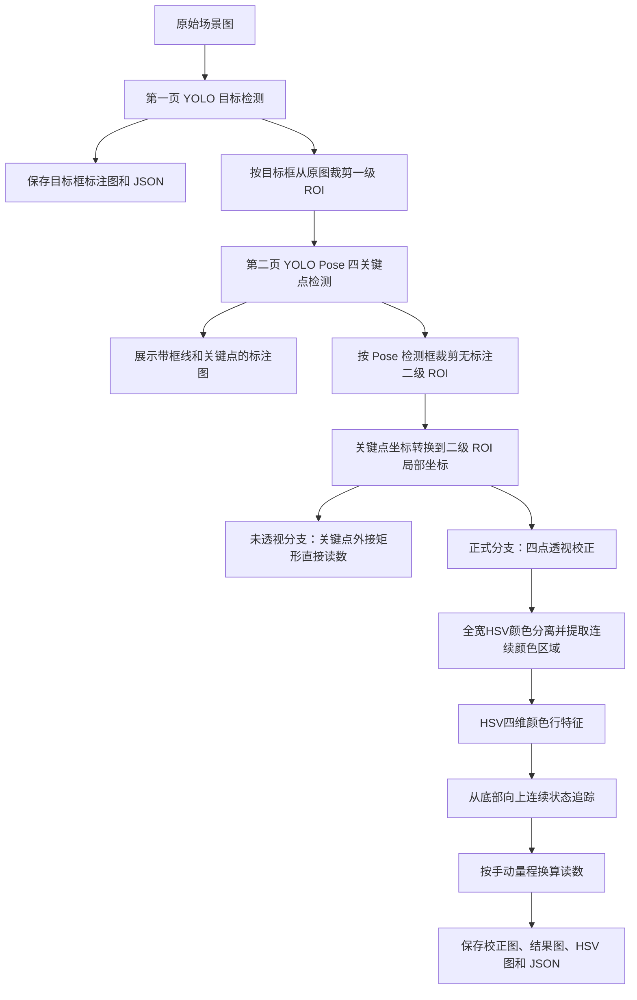

# 磁翻板液位计展示系统：全部主要算法代码逐段讲解

## 1. 文档范围

本文按照程序实际执行顺序，逐段解释当前展示系统的主要代码、算法、输入输出和坐标变化。对应代码文件如下：

- `app.py`：Tkinter 界面、页面联动、后台线程和结果展示；
- `services.py`：目标检测、关键点检测、裁剪、透视校正、读数与保存；
- `config.py`：模型路径、推理尺寸和默认阈值；
- `legacy/detect_pose_keypoints_yolo.py`：关键点数据整理和关键点绘制；
- `direct_hsv_reader.py`：在校正矩形完整宽度中自适应定位翻片颜色区域，并分析连续分界；
- `legacy/read_level_roi.py`：保留旧版 HSV 行特征和最大变化峰算法，仅用于历史对照；
- `explain_strip_search.py`：旧版候选扫描的历史分析工具，不参与当前正式读数。

程序启动入口：

```powershell
python level_gauge_showcase/app.py
```

## 2. 当前完整数据流



正式读数采用透视校正分支。未透视分支仅用于可视化对比。

## 3. 配置参数

对应文件：`config.py`。

```python
OBJECT_CONFIDENCE = 0.25
OBJECT_IMGSZ = 640
POSE_CONFIDENCE = 0.20
POSE_IMGSZ = 960
```

### 3.1 目标检测使用 640

目标检测只需要得到完整液位计的大致外接框。检测框允许存在少量像素误差，因此使用 `640` 可以兼顾速度、显存和检测精度。

### 3.2 关键点检测使用 960

关键点直接用于透视矩阵计算，几像素误差就可能导致校正图仍然倾斜。因此关键点模型使用 `960`，为细长液位计提供更多空间采样点。

输入面积计算量大致满足：

```text
(960 / 640)² = 2.25
```

所以 960 的计算量明显更高，但关键点定位更需要高分辨率。

### 3.3 模型延迟加载

`ObjectDetectionService.model` 和 `PoseDetectionService.model` 都采用延迟加载：

```python
if self._model is None:
    self._model = YOLO(str(self.model_path))
```

程序启动时不会立即加载两套权重，只有第一次执行对应检测时才加载模型，之后复用同一模型对象。

## 4. 中文路径图片读写

对应函数：`services.py` 中的 `read_image`、`write_image` 和 `write_json`。

### 4.1 图片读取

```python
encoded = np.fromfile(path, dtype=np.uint8)
image = cv2.imdecode(encoded, cv2.IMREAD_COLOR)
```

没有直接使用 `cv2.imread`，而是先通过 NumPy 读取文件字节，再由 OpenCV 解码。这样可以更稳定地处理 Windows 中文路径。

### 4.2 图片保存

```python
success, encoded = cv2.imencode(extension, image)
encoded.tofile(path)
```

先在内存中编码，再由 NumPy 写入中文路径。

### 4.3 JSON 保存

```python
json.dumps(payload, ensure_ascii=False, indent=2)
```

`ensure_ascii=False` 用于保留中文，`indent=2` 便于人工检查。

## 5. 内存数据结构

### 5.1 DetectionRecord

目标检测和关键点检测共用 `DetectionRecord`：

```text
source_path    输入图片路径
original       无标注原始像素
annotated      带检测结果的展示图
detections     检测框、置信度或关键点数据
task           object_detection / keypoint_detection
crops          从 original 裁剪的无标注 ROI
saved_crops    ROI 保存路径
```

最重要的是 `original` 和 `annotated` 分离。算法裁剪始终使用 `original`，避免框线、文字和关键点颜色污染后续 HSV。

### 5.2 ReadingRecord

第三页使用 `ReadingRecord` 保存完整读数过程：

```text
original                    第二页无标注裁剪 ROI
unrectified_visualization   未透视读数对比图
rectified_visualization     透视校正后的无标注标准矩形
annotated                   校正后的正式读数图
hsv_visualization           H/S/V 分析图
reports                     正式校正分支数据
unrectified_reports         未校正对比数据
```

## 6. 第一页：YOLO 目标检测

对应函数：`ObjectDetectionService.detect`。

### 6.1 调用模型

```python
predictions = self.model.predict(
    source=[str(path) for path in image_paths],
    conf=confidence,
    imgsz=OBJECT_IMGSZ,
    iou=0.7,
    max_det=20,
    stream=True,
)
```

主要参数：

- `conf`：低于阈值的目标被过滤；
- `imgsz=640`：目标检测推理尺寸；
- `iou=0.7`：NMS 重叠框抑制阈值；
- `max_det=20`：单图最多保留20个目标；
- `stream=True`：按预测结果流式返回，适合批量图片。

### 6.2 解析检测框

模型输出转换为 CPU NumPy 数据：

```python
boxes = prediction.boxes.xyxy.cpu().numpy()
confidences = prediction.boxes.conf.cpu().numpy()
classes = prediction.boxes.cls.cpu().numpy().astype(int)
```

每个目标保存：

```json
{
  "detection_id": 1,
  "class_id": 0,
  "class_name": "flap",
  "box_xyxy": [x1, y1, x2, y2],
  "confidence": 0.84
}
```

坐标原点位于图片左上角，`x` 向右增加，`y` 向下增加。

### 6.3 绘制检测结果

`_draw` 在 `original.copy()` 上绘制绿色框和置信度，不会修改原始像素：

```python
cv2.rectangle(annotated, (x1, y1), (x2, y2), ...)
cv2.putText(annotated, label, ...)
```

### 6.4 一级 ROI 裁剪

对应函数：`ObjectDetectionService.crop_record`。

```python
x1 = max(0, x1)
y1 = max(0, y1)
x2 = min(width, x2)
y2 = min(height, y2)
crop = record.original[y1:y2, x1:x2].copy()
```

这里有三个关键点：

1. 浮点检测框先四舍五入为整数；
2. 坐标被限制在原图范围内；
3. 裁剪使用 `record.original`，不是界面缩略图，也不是带框标注图。

### 6.5 自动保存

第一页每完成一张图片，`DetectionTab._accept_record` 自动执行：

```text
保存标注图
保存检测 JSON
从原图裁剪全部目标 ROI
保存 ROI
```

## 7. GUI 批量检测与后台线程

对应函数：`DetectionTab.start_detection`、`_detect_worker`、`_accept_record`。

### 7.1 为什么使用线程

YOLO 推理如果直接在 Tkinter 主线程执行，窗口会停止刷新。因此程序创建后台线程：

```python
threading.Thread(target=self._detect_worker, daemon=True).start()
```

### 7.2 为什么又用 after

模型推理在后台线程运行，但 Tkinter 控件必须由主线程更新：

```python
self.after(0, self._accept_record, record, number, total)
```

`after(0, ...)` 把界面更新任务放回 Tkinter 主事件循环。

### 7.3 多图处理顺序

```python
for number, path in enumerate(paths, start=1):
    record = self.service.detect([path], confidence=confidence)[0]
```

多图按用户选择顺序逐张检测、逐张保存、逐张加入结果列表。

## 8. 第一页 ROI 直接传给第二页

对应函数：`DetectionTab.choose_object_rois`。

第二页“读取第1页 ROI 结果”不会打开文件选择框，而是读取第一页当前会话中的：

```text
object_tab.records
record.crops
record.saved_crops
```

如果 ROI 还没有生成，则调用：

```python
self.app.object_service.crop_record(record)
self.app.object_service.save_crops(record)
```

然后把全部一级 ROI 路径加入第二页待检测列表。

## 9. 第二页：YOLO Pose 四关键点检测

对应函数：`PoseDetectionService.detect`。

### 9.1 模型调用

```python
predictions = self.model.predict(
    imgsz=POSE_IMGSZ,
    batch=8,
    iou=0.7,
    max_det=10,
    stream=True,
)
```

关键点模型输入尺寸为960，批量推理最多按8张组织。

### 9.2 关键点数据整理

`build_detection_records` 从模型输出中取得：

```python
keypoints = prediction.keypoints.xy.cpu().numpy()
keypoints_normalized = prediction.keypoints.xyn.cpu().numpy()
keypoint_confidences = prediction.keypoints.conf.cpu().numpy()
```

四点顺序固定为：

```text
TL：左上
TR：右上
BR：右下
BL：左下
```

每个关键点目标保存：

```text
box_xyxy                   检测框
box_confidence             检测框置信度
keypoints_xy_pixels        像素坐标
keypoints_xy_normalized    归一化坐标
keypoint_confidences       每个关键点置信度
roi_quad_tl_tr_br_bl       透视变换使用的四边形
```

### 9.3 第二页展示图

`draw_pose_results` 在原图副本上绘制：

- 青色目标框；
- 四点连线；
- TL、TR、BR、BL 圆点；
- 检测框和关键点置信度。

该图只用于展示，第三页不会使用它做 HSV 计算。

### 9.4 二级 ROI 裁剪

第二页也会调用 `PoseDetectionService.crop_record`，使用 Pose 检测框从第二页无标注输入图中裁剪 ROI，并保存到：

```text
outputs/keypoint_detection/roi_crops/
```

所以当前存在两级裁剪：

```text
一级 ROI：第一页目标检测框裁剪
二级 ROI：第二页 Pose 检测框裁剪
```

## 10. 第一、二页“查看检测结果”

对应函数：`DetectionTab.show_details`。

弹窗左侧显示带绘制的检测结果图，右侧显示数据：

- 输入路径和原图尺寸；
- 目标数量；
- 类别；
- 检测框 `[x1,y1,x2,y2]`；
- 检测框置信度；
- 关键点坐标；
- 每个关键点置信度。

## 11. 第二页到第三页：裁剪图与关键点坐标转换

对应函数：`ReadingTab._use_detection_record`。

这是当前流程最重要的坐标步骤。

### 11.1 第三页读取什么图片

第三页不会读取：

- 第二页裁剪前的输入图；
- 第二页带关键点的标注图。

第三页读取的是：

```text
outputs/keypoint_detection/roi_crops/...
```

也就是第二页 Pose 检测框裁剪得到的无标注二级 ROI。

### 11.2 为什么关键点必须减去裁剪框左上角

Pose 模型输出的关键点坐标属于第二页输入图坐标系。二级 ROI 裁剪后，新的左上角变成 `(0,0)`，所以必须转换：

```python
local_x = point_x - crop_x1
local_y = point_y - crop_y1
```

代码为：

```python
local_quad = [[
    float(point[0]) - x1,
    float(point[1]) - y1,
] for point in source_quad]
```

如果不做这一步，第三页会拿原图坐标在裁剪图上计算透视矩阵，产生严重错位。

### 11.3 当前多目标行为

第二页支持检测多个目标，但第三页“使用关键点检测当前图片/数据”目前读取当前记录中的第一个有效目标：

```python
detection, crop_box, source_quad = valid_targets[0]
crop_path = record.saved_crops[0]
```

如果需要在第三页处理同一图片中的多个液位计，后续应增加目标选择器或逐目标队列。

## 12. 第三页入口模式

对应函数：`ReadingService.read`。

第三页支持四种输入情况。

### 12.1 重新调用关键点模型

```python
if call_model:
    detection_record = self.pose_service.detect([image_path])[0]
```

选择任意无标注图片后，可以重新调用 Pose 模型，得到四点后执行透视校正。

### 12.2 使用第二页已有关键点

```python
elif existing_quads:
    quads = existing_quads
```

这是展示流程的正式路径，不重复调用模型。

### 12.3 只有检测框

如果只有 `existing_boxes`，程序执行普通矩形裁剪，不执行透视校正，主要用于兼容第一页数据。

### 12.4 没有任何数据

如果既没有检测框也没有关键点，程序把当前整图作为 ROI。

## 13. 未透视校正对比分支

对应函数：`ReadingService._crop_quad_bounding_box` 和 `ReadingService.read` 中的 `raw_roi` 分支。

### 13.1 关键点外接矩形

先计算四关键点的最小、最大横纵坐标：

```text
x1 = floor(min(point_x))
y1 = floor(min(point_y))
x2 = ceil(max(point_x)) + 1
y2 = ceil(max(point_y)) + 1
```

然后普通裁剪：

```python
raw_roi = image[y1:y2, x1:x2]
```

这个分支不执行 `warpPerspective`，因此仍保留原有倾斜和透视关系。

### 13.2 未校正读数

未校正 ROI 也调用 `analyze_direct_flap_strip`，在完整宽度中自适应定位颜色带，得到：

```text
raw_sx1, raw_sx2   自适应检测的翻片颜色区域
raw_level_y        分界位置
raw_confidence     上下状态分离度与连续性置信度
raw_reading        未校正换算读数
```

橙色横线和 `RAW` 标签表示该分支结果。它只用于校正前后对比，不作为正式输出读数。

## 14. 四关键点透视校正

对应函数：`ReadingService._rectify_quad`。

### 14.1 输入顺序

```text
points = [TL, TR, BR, BL]
```

程序检查输入必须为 `4×2` 且全部为有效数值，然后把坐标限制到图片范围内。

### 14.2 目标矩形宽度

分别计算上边和下边长度：

```text
top_width    = ‖TR - TL‖
bottom_width = ‖BR - BL‖
target_width = max(top_width, bottom_width)
```

### 14.3 目标矩形高度

分别计算左边和右边长度：

```text
left_height  = ‖BL - TL‖
right_height = ‖BR - TR‖
target_height = max(left_height, right_height)
```

取最大值可以减少目标矩形把较长一侧压缩掉的问题。

### 14.4 目标四角

```python
destination = [
    [0, 0],
    [target_width - 1, 0],
    [target_width - 1, target_height - 1],
    [0, target_height - 1],
]
```

### 14.5 单应性矩阵

```python
matrix = cv2.getPerspectiveTransform(points, destination)
```

它求解一个 `3×3` 矩阵 `H`，满足齐次坐标关系：

```text
[x', y', w']ᵀ = H [x, y, 1]ᵀ
最终坐标 = [x'/w', y'/w']
```

### 14.6 生成校正图

```python
rectified = cv2.warpPerspective(
    image, matrix, (target_width, target_height)
)
```

四边形被映射成标准矩形。第三页正式读数只在该校正图中进行。

### 14.7 透视校正的限制

单应性变换本身是确定性的，最终效果取决于四关键点是否准确。如果关键点落在刻度、外壳或背景上，校正后仍可能倾斜，因此后续可增加边缘拟合修正。

## 15. 旧版翻片条带每行特征（仅供历史对照）

对应函数：`legacy/read_level_roi.py` 中的 `extract_row_features`。

### 15.1 颜色空间转换

```python
hsv = cv2.cvtColor(strip, cv2.COLOR_BGR2HSV)
gray = cv2.cvtColor(strip, cv2.COLOR_BGR2GRAY)
```

HSV 用于分离色相、饱和度和亮度，灰度用于纹理和边缘。

### 15.2 Hue 循环编码

OpenCV Hue 范围是 `0～179`，但它是圆环，0和179相邻。程序将 Hue 转换为角度：

```text
θ = H × 2π / 180
Hcos = cos(θ) × S/255
Hsin = sin(θ) × S/255
```

这样不会把两个接近红色的 `H=1` 和 `H=179` 错误平均成中间色。

乘以饱和度是因为白、灰、黑区域的 Hue 不可靠，应降低权重。

### 15.3 Saturation 均值和标准差

```text
S mean：该行整体颜色是否鲜明
S std：该行内部颜色纯度是否均匀
```

### 15.4 Value 均值和标准差

```text
V mean：该行平均亮度
V std：该行内部亮暗变化
```

### 15.5 灰度标准差

```python
gray.std(axis=1)
```

表示一行内部的对比度和纹理强度。数字、刻度、反光会提高该值。

### 15.6 水平梯度边缘能量

```python
grad_x = abs(Sobel(gray, dx=1, dy=0))
grad_x.mean(axis=1)
```

这里计算的是沿 `x` 方向的亮度变化，所以主要突出竖直边缘，例如条带左右边界和数字竖笔画。

### 15.7 最终8维行特征

```text
H cos
H sin
S mean
S std
V mean
V std
gray std
edge energy
```

## 16. 旧版行特征平滑与鲁棒归一化（正式流程不再调用）

### 16.1 高斯平滑

`smooth_columns` 沿图像纵向平滑特征：

```python
GaussianBlur(values, (1, kernel), sigmaY=sigma)
```

用于减弱单片间隙、噪点和局部反光。

### 16.2 中位数和 MAD

```text
median = 特征中位数
MAD = median(|feature - median|)
normalized = (feature - median) / max(1.4826×MAD, 1)
```

与均值、标准差相比，中位数和 MAD 对局部强反光、污点和异常值更稳定。

最后限制到：

```text
[-8, 8]
```

防止单个特征异常值支配整体距离。

## 17. 旧版最大变化峰检测（正式流程不再调用）

对应函数：`find_change_point`。

### 17.1 窗口大小

```python
window = max(12, round(height * 0.08))
```

每个候选位置都比较上方约8%高度窗口和下方约8%高度窗口。

### 17.2 累积和加速

程序先构造特征累积和：

```python
cumulative = vstack([zeros, cumsum(features, axis=0)])
```

因此任意窗口均值可以通过两次累积值相减得到，避免每个位置重复求和。

### 17.3 上下特征距离

对候选位置 `y`：

```text
above = y上方窗口平均特征
below = y下方窗口平均特征
score(y) = ‖above - below‖₂
```

它不是只比较红色，而是综合比较8维颜色、亮度、纹理和边缘特征。

### 17.4 搜索边界

顶部和底部至少排除5%，并确保上下窗口完整：

```text
start = max(window, 5%H)
end = min(H-window, 95%H)
```

### 17.5 最大变化位置

得分平滑后：

```python
level_y = int(np.argmax(score))
```

该位置被认为是上下翻片状态的分界。

## 18. 全宽自适应定位磁翻板颜色区域

对应文件：`direct_hsv_reader.py`；对应函数：`locate_colour_strip_by_dense_columns` 和 `analyze_direct_flap_strip`。

### 18.1 设计依据

固定中央24%可能因关键点偏移、不同型号宽度或翻片偏心而漏掉目标，因此正式算法不再预先指定中心和宽度，而是在校正图完整宽度上逐列检测底部连续状态的终止高度。

```text
搜索宽度 = 校正矩形完整宽度
条带左右边界 = 分界高度稳定且横向连续的有效列区域
条带高度 = 校正矩形完整高度
```

### 18.2 逐列建立底部连续分界图

```text
boundary_map(x) = 第x列局部窗口从底部连续状态终止的y坐标
```

程序以约校正图宽度10%的小窗口逐列计算循环Hue、S、V行特征。每个窗口都执行底部种子、短间隙闭合和上下状态一致率检查；通过检查后，记录该列的分界高度和连续性置信度。该过程得到完整宽度上的稠密分界图，而不是预设若干条带宽度。

### 18.3 连续区域和可靠性筛选

将相邻且分界高度相近的有效列组合成区域。区域必须满足：

- 单列连续性置信度至少为2.5；
- 相邻列分界高度差不超过约2.5%图高；
- 只允许跨过极少量无效列；
- 区域宽度至少为校正图的8%且不超过65%；
- 整个区域重新汇总后仍能形成可靠的底部连续状态。

红色反光如果在约50刻度处变化，而实际翻片在约60刻度处变化，两组列会因为分界高度不同自动拆开。最终按有效宽度、分界高度稳定性和连续性置信度选择区域；中心距离仅保留10%的弱排序权重，不会限制区域必须位于中央。

如果没有满足条件的区域，程序直接拒绝读数，不回退到中央24%。这能避免“没有裁到翻片却仍然给出数字”。

### 18.4 纵向范围就是完整量程

颜色带直接裁剪为：

```python
strip = rectified_image[0:height, x1:x2]
```

不再寻找量程顶部和底部，默认：

```text
y=0       → 手动量程上限
y=H-1     → 手动量程下限
```

### 18.5 正式流程使用的四维颜色行特征

`direct_hsv_reader.py` 对自适应颜色带每一行计算颜色状态：

```text
H cos × S
H sin × S
S mean
V mean
```

Hue 使用正弦、余弦表示，避免0和179在色环首尾处不连续；乘以饱和度后，灰白区域中无意义的 Hue 不会产生过大影响。四维特征沿纵向进行高斯平滑，削弱单片缝隙和像素噪声。

### 18.6 从底部建立颜色状态

算法忽略上下各5%的端部边缘，并在顶部、底部各取约10%高度，使用中位特征分别建立 `top_reference` 和 `bottom_reference`：

```text
state_axis = bottom_reference - top_reference
midpoint = (top_reference + bottom_reference) / 2
bottom_score(y) = dot(feature(y)-midpoint, state_axis)
                  / dot(state_axis, state_axis)
```

`bottom_score > 0` 表示该行更接近底部颜色。顶部和底部参考的距离小于0.05时，说明两种翻片状态无法可靠区分，程序直接拒绝读数。

### 18.7 连续性约束

二值底部状态先执行纵向闭运算，只连接不超过约2.5%图高的短间隙，以容忍翻片缝隙、反光或少量污渍。随后从有效底部向上逐行追踪，第一次离开底部连通状态的位置就是 `level_y`。

同时要求：

- 底部参考区域至少70%的行属于底部状态；
- 分界上方至少70%的行属于上部状态；
- 分界下方至少70%的行属于底部状态；
- 分界上方不能重新出现长度超过允许短间隙的底部状态块，否则按遮挡或多重分界拒绝；
- 分界不能落在顶部或底部5%的端点附近。

任一条件不满足都会返回明确错误，而不是强行给出一个最大变化峰。

### 18.8 连续性置信度

置信度综合上下两段状态得分的中位差、MAD波动和较小的一侧一致率。它衡量“两段颜色状态是否分离且连续”，不是 YOLO 概率。JSON 中同时保存 `continuity_confidence` 和详细的 `continuity_metrics`；旧字段 `change_confidence_z` 暂时保留用于兼容已有数据读取代码。

### 18.9 相对旧算法的变化

旧算法需要比较76个预设位置和宽度组合；上一版又把中央24%设为硬约束。当前算法取消两种固定裁剪，在全宽响应图中只提取由当前图片数据形成的连续颜色区域。

### 18.10 历史条带搜索分析脚本

`explain_strip_search.py` 保留旧版76候选算法的分析图生成能力：

```text
01 目标检测ROI
02 候选竖条带扫描
03 候选质量热力图
04 最终条带及放大图
05 最终条带变化分数曲线
```

它只用于对比旧算法，不参与当前 GUI 正式读数。

## 19. 正式分支读数计算

对应 `ReadingService.read` 中对校正 `roi` 的处理。

### 19.1 自适应定位翻片颜色带并检测分界

```python
analysis = analyze_direct_flap_strip(roi)
sx1, sx2 = analysis.x1, analysis.x2
level_y = analysis.level_y
confidence = analysis.confidence
```

返回：

```text
sx1, sx2   全宽颜色响应中自动得到的左右边界
level_y    校正图中的上下状态分界
confidence 上下状态分离度与连续性置信度
```

### 19.2 量程比例

假设：

- 校正图顶部对应量程上限；
- 校正图底部对应量程下限。

比例公式：

```text
ratio = (H - 1 - level_y) / (H - 1)
```

因为图像 `y` 向下增加，所以必须使用 `H-1-level_y` 反转方向。

### 19.3 读数换算

```text
reading = scale_min + ratio × (scale_max - scale_min)
```

最后使用 `clip` 限制在手动量程范围内。

### 19.4 示例

本项目样图实测：

```text
校正图高度 H = 613
level_y = 245
量程 = 0～100
```

则：

```text
ratio = (612 - 245) / 612 ≈ 0.5997
reading ≈ 59.97
```

## 20. 正式结果绘制

在校正后的无标注图副本上绘制：

```text
青色竖框：从校正矩形完整宽度中自适应定位的翻片颜色带
黄色横线：上下状态分界
文字：正式读数
```

这张图保存为 `read_roi/images/` 中的正式结果图。

## 21. HSV 可视化图生成

对应函数：`ReadingService._make_hsv_visualization`。

### 21.1 只分析选中的条带

```python
strip = roi[:, sx1:sx2]
hsv = cv2.cvtColor(strip, cv2.COLOR_BGR2HSV)
```

### 21.2 HUE 伪彩色

Hue 本身是单通道数值。为了可视化，程序固定：

```text
S=255
V=255
```

再转换回 BGR，得到高饱和度色相图。该图不是原图真实颜色，只用于观察 Hue 变化。

### 21.3 Saturation 和 Value

S、V 分别转成灰度三通道：

```text
越白：数值越高
越黑：数值越低
```

### 21.4 BOTTOM STATE 连续状态图

第四个面板显示执行短间隙闭运算后的连通状态：

```text
绿色：从底部向上连通的底部颜色状态
蓝色：上部颜色状态
红线：底部连通区域的上边界，即 level_y
```

H、S、V 和 BOTTOM STATE 四个面板都在同一 `level_y` 位置绘制红线，保证可视化与正式读数位置一致。

### 21.5 为什么放大使用最近邻

```python
INTER_NEAREST
```

最近邻不会引入额外插值颜色，更适合展示原始离散通道数据。

## 22. 多目标图像拼接

对应 `_stack_images` 和 `_stack_hsv_views`。

如果一张图片中存在多个液位计，各目标校正后的宽度可能不同。程序先找到最大宽度，在右侧补黑边，再纵向拼接：

```text
目标1结果
黑色间隔
目标2结果
```

当前通过第二页按钮进入第三页时只传递第一个有效目标，但 `ReadingService` 本身支持多组四关键点。

## 23. 第三页四个展示区域

第三页主界面依次显示：

1. 第二页检测框裁剪后的无标注二级 ROI；
2. 关键点外接矩形、不执行透视的读数对比图；
3. 四关键点透视校正后的无标注标准矩形；
4. 在标准矩形上完成的正式 ReadROI 结果。

HSV 图不常驻主界面。点击“查看检测结果”后，`show_hsv_result` 才弹出完整 H/S/V/BOTTOM STATE 图和读数详情。

## 24. 界面图片为什么不会改变算法尺寸

`ImagePanel._redraw` 使用 Pillow：

```python
pil.thumbnail((width, height), Image.Resampling.LANCZOS)
```

这里只生成供 Tkinter 显示的缩略副本。模型、裁剪和读数使用的仍是 `record.original` 或磁盘原始像素。

因此：

```text
界面显示尺寸 ≠ 算法处理尺寸
```

## 25. JSON 数据读取

### 25.1 检测框读取

`load_boxes_from_json` 兼容：

```text
box_xyxy
box
gauge_box_xyxy
```

### 25.2 四关键点读取

`load_quads_from_json` 按顺序尝试：

```text
roi_quad_tl_tr_br_bl
keypoints_xy_pixels
keypoints
```

只接受4个二维坐标。

## 26. 结果自动保存

### 26.1 第一页

```text
outputs/object_detection/detected_images/
outputs/object_detection/data/
outputs/object_detection/roi_crops/
```

### 26.2 第二页

```text
outputs/keypoint_detection/detected_images/
outputs/keypoint_detection/keypoints/
outputs/keypoint_detection/roi_crops/
```

### 26.3 第三页

```text
outputs/read_roi/unrectified_comparison/
outputs/read_roi/rectified_images/
outputs/read_roi/flap_color_strips/
outputs/read_roi/images/
outputs/read_roi/hsv_results/
outputs/read_roi/data/
```

第三页 JSON 保存：

- 输入图片和尺寸；
- 手动量程；
- 数据来源模式；
- 原始四关键点；
- 透视矩阵；
- 校正后尺寸；
- 未校正和校正后读数；
- 翻片条带位置；
- 液面分界位置；
- 连续性置信度；
- 底部种子一致率、上下状态一致率、允许短间隙长度等连续性指标；
- 各结果图片路径。

## 27. 当前实际样例的完整坐标变化

以 `flap_20260817_0789__i00` 为例：

```text
原始场景图：135×690
第一页目标框：[26, 26, 110, 690]
一级ROI：84×664
第二页Pose检测框裁剪：81×625
第二页关键点转换为二级ROI局部坐标
透视校正结果：58×613
自适应颜色带：x=25～38，宽13像素，使用完整613像素高度
未校正读数：87.296
校正后分界：y=244
校正后正式读数：60.131（量程0～100）
底部种子一致率：100%
上部/下部状态一致率：100% / 100%
```

该样例说明：透视校正后，程序能够从有效底部向上找到连续的下部翻片状态，并在该状态终止处确定分界，不再被顶部结构的孤立强变化峰抢占。

## 28. 当前主要风险

### 28.1 关键点误差

四关键点直接决定透视矩阵。建议后续在网络关键点附近增加边缘直线拟合和矩形几何约束。

### 28.2 自适应颜色区域仍需排除反光

新算法不会因固定中央和固定宽度直接漏掉翻片，但刻度板若产生与翻片相似且连续的颜色反光，仍可能形成候选区域。当前通过区域内外颜色差、宽度连续性和底部状态连续性联合筛选；后续可继续加入翻片周期纹理或由模型直接分割翻片区域。

### 28.3 量程锚点假设

当前默认校正图顶部、底部分别对应量程上限、下限。如果关键点没有覆盖真实有效刻度全长，会产生系统误差。

### 28.4 遮挡和反光

遮挡可能使关键点或连续颜色状态断裂。当前算法可闭合约2.5%图高以内的短间隙，并用70%一致率门限拒绝不可靠结果；如果遮挡跨度更大，程序会停止底部连通追踪或拒绝读数，后续可增加分段拟合和遮挡区域显式检测。

### 28.5 多目标交互

服务层支持多目标，但页面间按钮目前默认传递当前记录中的第一个有效 Pose 目标。后续可以增加目标编号选择。

## 29. 建议的后续算法顺序

```text
目标检测
→ 一级ROI
→ Pose关键点
→ 二级ROI和局部坐标
→ 边缘拟合修正四点
→ 透视校正
→ 检测有效刻度上下锚点
→ 检测具有周期性的纯翻片条带
→ HSV四维颜色行特征
→ 底部颜色种子与短间隙闭合
→ 从底部向上连续追踪
→ 量程换算和置信度判断
```

## 30. 总结

当前代码已经形成以下闭环：

```text
场景图
→ YOLO目标框
→ 原图ROI
→ YOLO Pose四点
→ 无标注二级ROI
→ 关键点局部坐标
→ 未校正对比
→ 四点透视校正
→ 全宽HSV响应并自适应提取翻片颜色区域
→ 底部起始的连续HSV状态分界
→ 手动量程读数
→ 四图展示和完整JSON
```

程序的核心原则是将“带绘制的展示图”和“无标注算法输入图”分开，并在每次裁剪后显式转换坐标系，从而保证关键点、透视变换和 HSV 读数使用相互一致的像素坐标。
